<p align="center">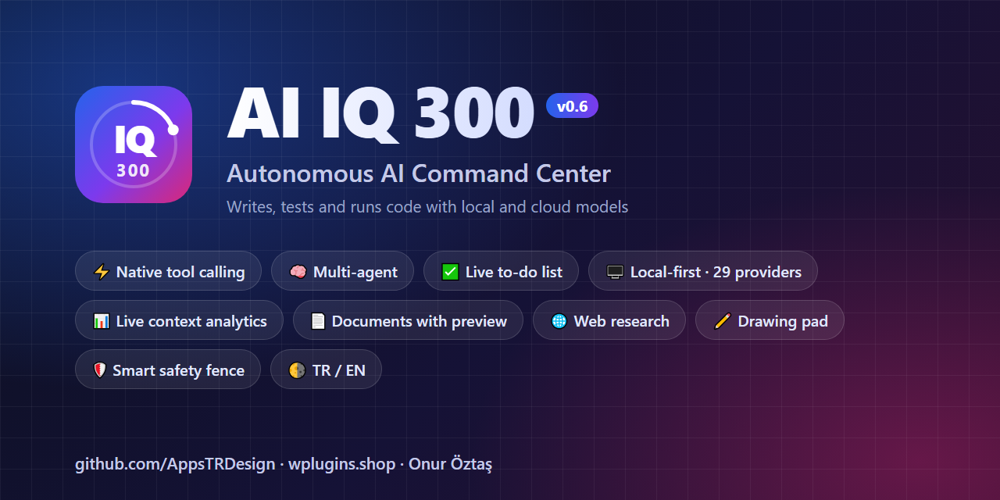</p>

<p align="center">
  <b>An autonomous AI command center that writes, tests and runs code with local and cloud AI models.</b><br>
  <a href="README.tr.md">Türkçe</a> · <a href="https://github.com/AppsTRDesign">GitHub</a> · <a href="https://wplugins.shop">wplugins.shop</a>
</p>

<p align="center">
  
  
  
  
  
  
</p>

---

## ✨ What is AI IQ 300?

AI IQ 300 is a **software development and automation hub** that runs on your own computer behind a clean ChatGPT/Claude-style chat. Give it a goal: it creates folders and files, runs PowerShell/CMD/Python/Node/PHP commands, debugs errors, tests the app in a browser and reports back. Your data never leaves your computer unless you choose a cloud provider.

> Say "build a full e-commerce site in PHP". The project structure, database, UI and tests are built step by step. The model splits the work into a to-do list and you follow every step live in the chat.

## 🖼️ Screenshots

| Chat & activity | While a task runs: live steps and to-dos |
|---|---|
| 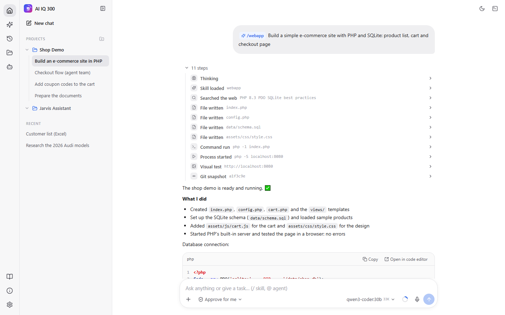 | 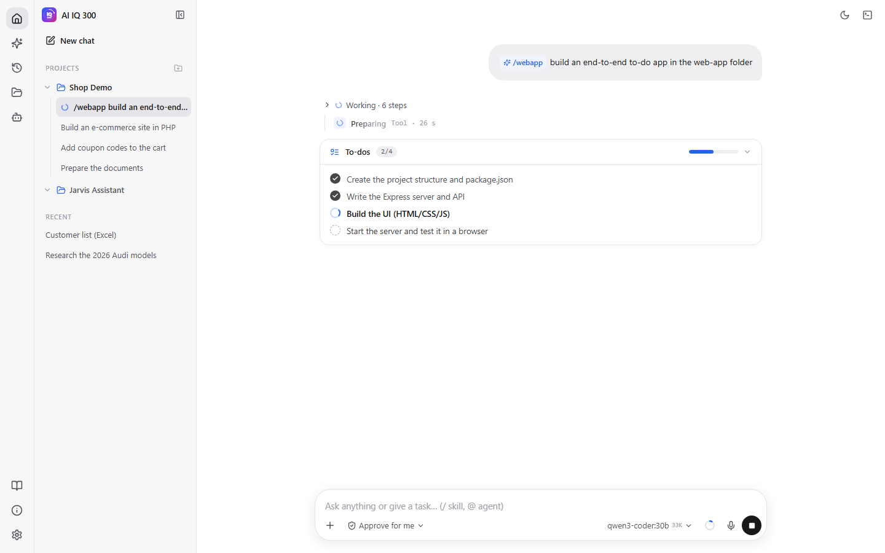 |
| **Document cards** | **Excel preview** |
| 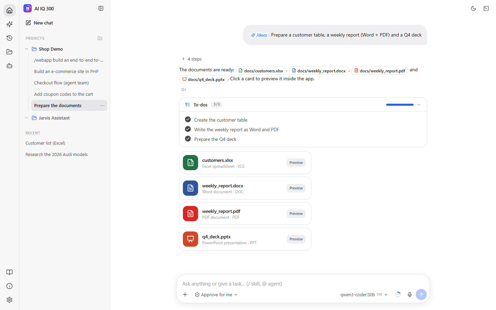 | 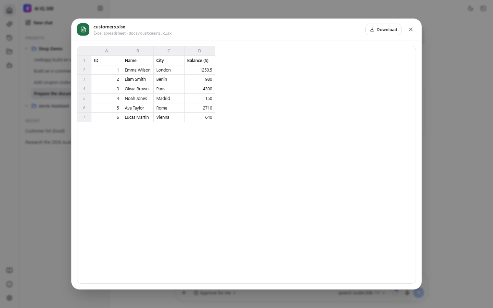 |
| **Word preview** | **Context size from the model picker** |
| 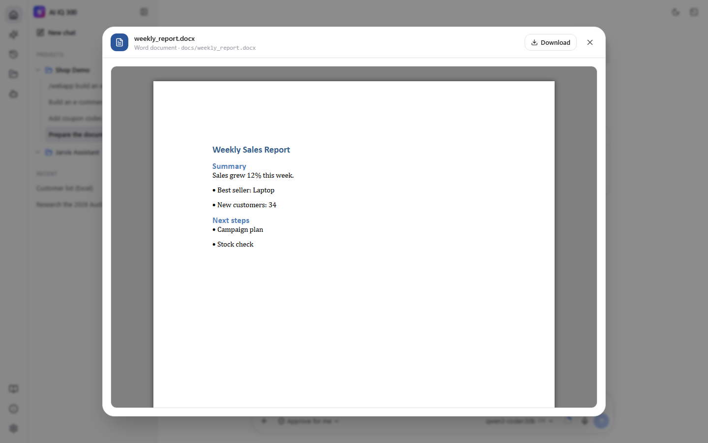 | 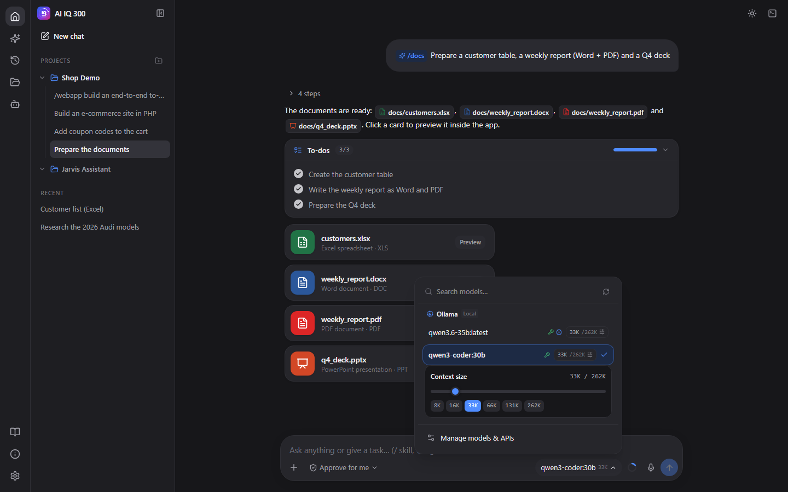 |
| **Context analytics** | **Drawing pad** |
| 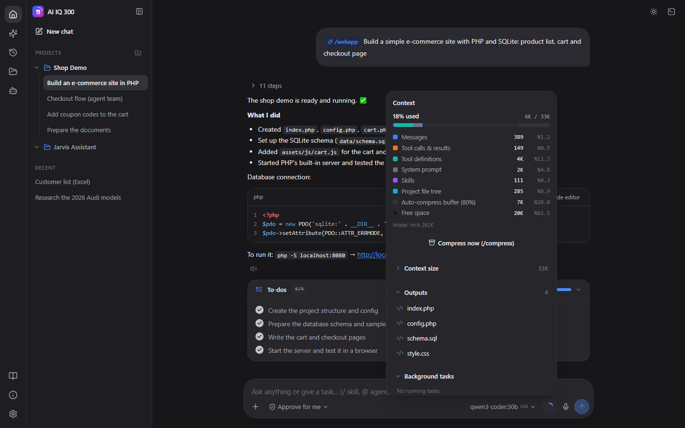 | 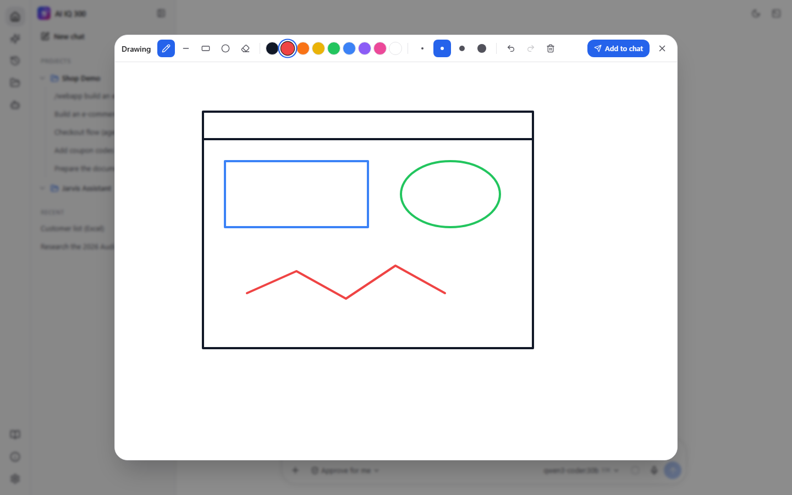 |
| **File manager** | **Providers** |
| 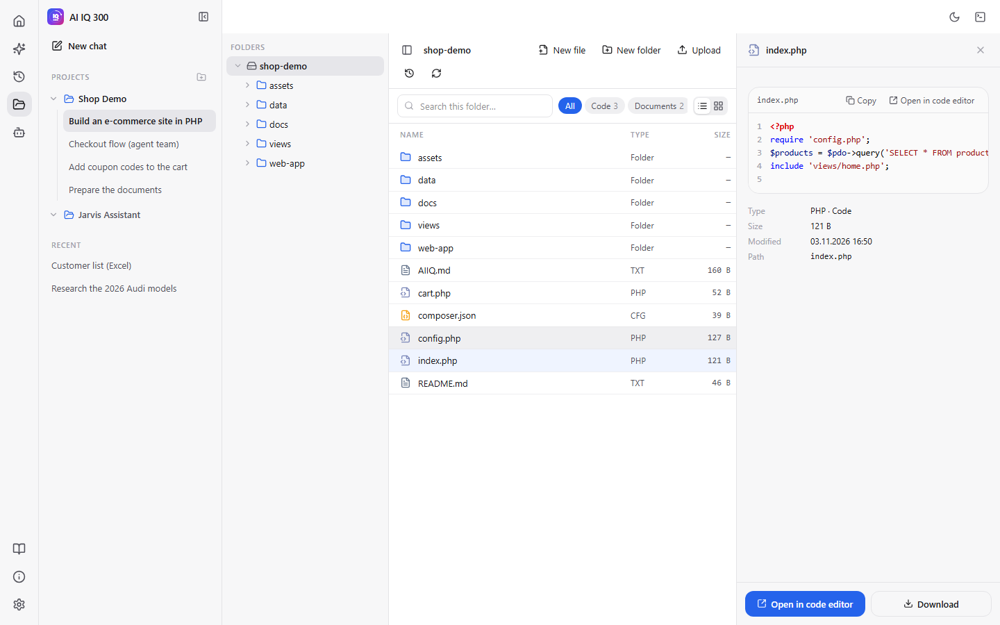 | 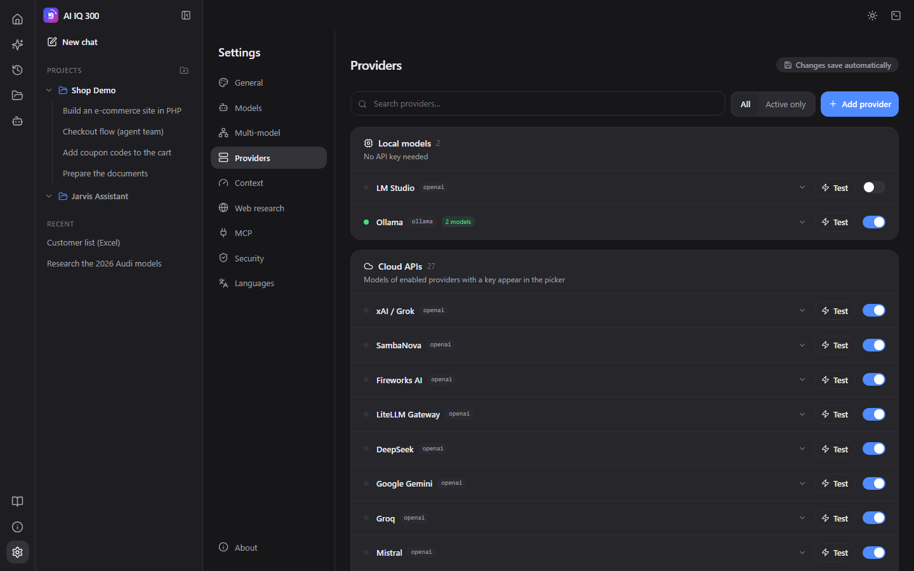 |
| **Plus menu** | **About** |
| 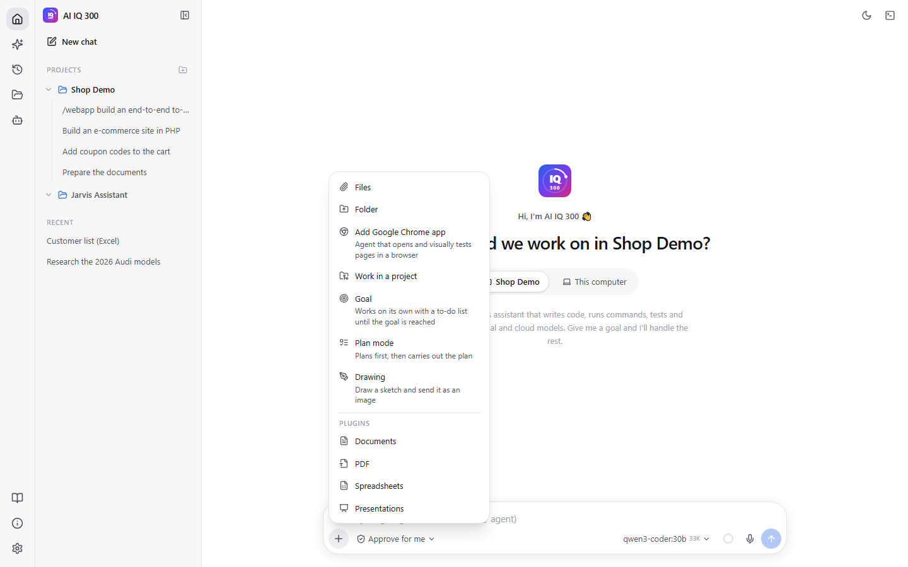 | 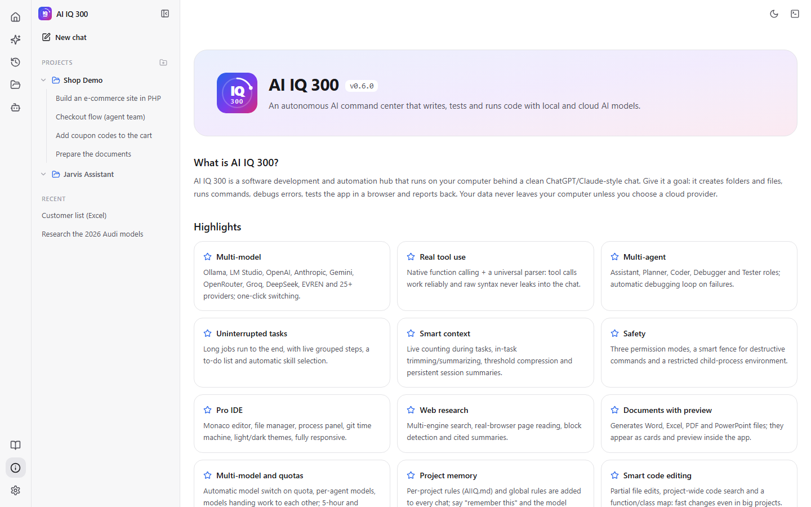 |

<p align="center">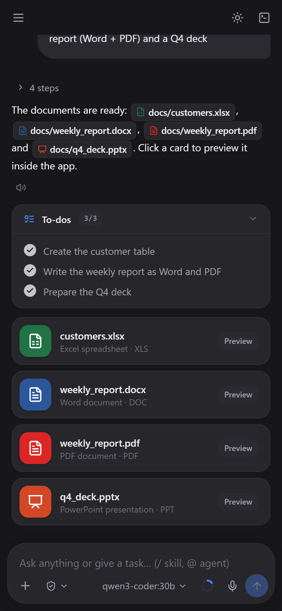<br><i>Mobile view (dark theme)</i></p>

## 🚀 Features

**Agents and orchestration**
- **Real tool use:** Native function calling for Ollama, OpenAI-compatible APIs and Anthropic. A universal parser also recognizes the Qwen-XML, Hermes-JSON and Mistral formats, so raw tool syntax never leaks into the chat.
- **Multi-agent:** Assistant, Planner, Coder, Debugger and Tester roles. An automatic debugging loop runs when a command fails; `@agent` switches roles.
- **Uninterrupted tasks:** Long jobs run to the end. If the model announces the next step and stops, returns nothing, or leaves to-do items open, the task is continued. Type "continue" to resume an interrupted task where it stopped.
- **Live to-do list:** For multi-step work the model opens a list when it needs one and ticks items off as it goes; the list stays in sync with the chat.
- **Automatic skill detection:** The model picks and loads the matching skill (web app, documents, git…) itself; `/skill` still invokes one by hand. An invoked skill applies to the latest request, not to an earlier topic.
- **Goal and plan modes:** In goal mode the model works on its own until the goal is reached; in plan mode it plans first.
- **Smart guards:** Repeated page fetches, false "I created a file" claims, invented absolute paths and replies in the wrong language are corrected automatically. Plain questions get read-only tools, so no unrequested files are written.

**Context and models**
- **Live context:** Context is counted at every step while a task runs. In long tasks old file bodies are trimmed and, if needed, steps are summarized, so a task never breaks because the window filled up. Per-category analytics, compression at an 80% threshold and persistent session summaries.
- **Context size from the model picker:** Change a local model's context with the size chip in the model picker (slider or 8K–262K presets); it stays in sync with Settings and the context panel instantly.
- **29 providers:** Ollama, LM Studio, OpenAI, Anthropic, Gemini, OpenRouter, Groq, DeepSeek, Mistral, xAI, Together, EVREN and more. Models load per provider in parallel, with tools/vision/thinking badges.
- **VRAM-friendly:** Switching to a local model unloads the other local models automatically.
- **Built for slow hardware:** While the model writes a file silently, a "Preparing · N s" indicator shows progress; long generations never time out.

**Workspace**
- **Pro IDE:** Monaco editor, a file manager with a folder tree and type filters, a process panel and a git time machine.
- **Documents with preview:** Word, Excel, PDF and PowerPoint. Generated documents appear as color-coded cards in the chat; click a card or a document path in the reply to preview it inside the app (Excel: SheetJS, Word: docx-preview, PDF: the browser viewer, PowerPoint: slide cards).
- **Drawing pad:** Pen, line, rectangle, ellipse, eraser, colors, undo/redo; the drawing is attached to the chat as an image.
- **Attachments:** File and folder upload (folder structure is kept), drag & drop, paste and voice typing.
- **Web research:** Multi-engine search with a relevance filter (off-topic hits are dropped), real-browser page reading, block detection and cited summaries. Bot protection is never bypassed.
- **Sessions:** Every chat keeps its transcript, summaries, state file and uploads in `chat/<id>-session/`.
- **Safety:** Three permission modes (Ask / Approve for me / Full access). Even in full access, a smart fence guards destructive commands.
- **UI:** Light/dark themes, fully responsive, menus that toggle open/closed on click; TR/EN built in and new languages translated automatically in one click (agent and skill texts included).

## 📦 Requirements

| Component | Version | Status | Used for |
|---|---|---|---|
| **Python** | 3.12 | ✅ Required | Backend (FastAPI) |
| **Node.js** (with npm) | 20+ (22 LTS recommended) | ✅ Required | Building the UI |
| **Git** | 2.40+ | ⭐ Recommended | Time machine, automatic commits |
| **Ollama** or **LM Studio** | latest | ⭐ For local models (either one) | Running models on your computer |
| **PHP** | 8.2+ | Optional | Running PHP projects |
| **WSL2 + Docker** | latest | Optional | Running projects in containers; the planned sandbox |
| **Browser** | Chrome / Edge / Firefox | ✅ Required | The UI |

> Don't want local models? Enter a cloud API key (OpenRouter, OpenAI, Anthropic, Gemini, EVREN…) in Settings > Providers.
> Recommended hardware: 16 GB+ RAM. With a GPU, 8 GB+ VRAM for 7B–14B models and 16–24 GB VRAM for 30B+ models. On systems without a supported GPU, 30B MoE models (e.g. `qwen3-coder:30b`) also run on the CPU with 32 GB RAM, just more slowly.

### 🪟 Windows 10 / 11

Run the commands in PowerShell. [winget](https://learn.microsoft.com/windows/package-manager/winget/) ships with Windows 11; or download the installers from the links.

| Component | Download | Install with winget |
|---|---|---|
| Python 3.12 | [python.org/downloads/windows](https://www.python.org/downloads/windows/) — tick **"Add python.exe to PATH"** | `winget install Python.Python.3.12` |
| Node.js LTS | [nodejs.org/en/download](https://nodejs.org/en/download) | `winget install OpenJS.NodeJS.LTS` |
| Git | [git-scm.com/download/win](https://git-scm.com/download/win) | `winget install Git.Git` |
| Ollama | [ollama.com/download/windows](https://ollama.com/download/windows) | `winget install Ollama.Ollama` |
| LM Studio | [lmstudio.ai](https://lmstudio.ai/) | `winget install ElementLabs.LMStudio` |
| PHP 8.2+ | [windows.php.net/download](https://windows.php.net/download/) — unzip and add the folder to PATH | — |
| Docker Desktop | [docs.docker.com/desktop/setup/install/windows-install](https://docs.docker.com/desktop/setup/install/windows-install/) | `winget install Docker.DockerDesktop` |

After installing, reopen the terminal and check the versions:

```bash
python --version
```
```bash
node --version
```

**WSL2 + Docker (optional):**

1. Open PowerShell **as administrator**, install WSL2 and restart the computer:
   ```bash
   wsl --install
   ```
2. Update WSL and check that the default version is 2:
   ```bash
   wsl --update
   ```
   ```bash
   wsl --status
   ```
3. Install Docker Desktop (table above), start it and make sure **Settings > General > Use the WSL 2 based engine** is ticked.
4. Verify it works:
   ```bash
   docker run hello-world
   ```

> Virtualization (Intel VT-x / AMD-V) must be enabled in the BIOS. Details: [learn.microsoft.com/windows/wsl/install](https://learn.microsoft.com/windows/wsl/install)

### 🐧 Linux (Ubuntu / Debian / Fedora)

**Ubuntu 24.04 / Debian 13** (Python 3.12+ in the repositories):

```bash
sudo apt update && sudo apt install -y python3 python3-venv python3-pip git curl
```

**Ubuntu 22.04** (Python 3.12 from the deadsnakes PPA):

```bash
sudo add-apt-repository -y ppa:deadsnakes/ppa && sudo apt update && sudo apt install -y python3.12 python3.12-venv git curl
```

**Fedora:**

```bash
sudo dnf install -y python3.12 git curl nodejs npm
```

**Node.js 22 LTS** (Ubuntu/Debian, [NodeSource](https://github.com/nodesource/distributions)):

```bash
curl -fsSL https://deb.nodesource.com/setup_22.x | sudo -E bash - && sudo apt install -y nodejs
```

**Ollama** ([ollama.com/download/linux](https://ollama.com/download/linux)):

```bash
curl -fsSL https://ollama.com/install.sh | sh
```

**LM Studio:** download the AppImage from [lmstudio.ai](https://lmstudio.ai/) and make it executable.

**PHP (optional):**

```bash
sudo apt install -y php-cli php-sqlite3 php-mbstring
```

**Docker Engine (optional,** [docs.docker.com/engine/install](https://docs.docker.com/engine/install/)**):**

```bash
curl -fsSL https://get.docker.com | sh
```
```bash
sudo usermod -aG docker $USER
```

Log out and back in, then verify:

```bash
docker run hello-world
```

### 🍎 macOS

With [Homebrew](https://brew.sh/): `brew install python@3.12 node git` · Ollama: [ollama.com/download/mac](https://ollama.com/download/mac) · Docker: [Docker Desktop for Mac](https://docs.docker.com/desktop/setup/install/mac-install/)

## 🛠️ Installation

`install.bat` / `install.sh` set up everything automatically: the Python virtual environment (`.venv`), the `requirements.txt` packages (FastAPI, Uvicorn, httpx, Playwright, python-docx, openpyxl, reportlab, python-pptx…), Playwright Chromium, and the UI packages plus build.

### Windows

```bash
install.bat
```
```bash
run.bat
```

### Linux / macOS

```bash
chmod +x install.sh run.sh
```
```bash
./install.sh
```
```bash
./run.sh
```

If Playwright's system libraries are missing (Linux):

```bash
sudo .venv/bin/python -m playwright install-deps
```

The app opens at `http://127.0.0.1:8300` (another port: `run.bat 9000` / `./run.sh 9000`). On first start the UI uses your system language (English if there is no translation).

**First model:** with Ollama installed, pull a model:

```bash
ollama pull qwen3-coder:30b
```

or add a cloud provider in Settings > Providers and press **Test**.

## 🧭 Usage

1. Create a project with **+** in the sidebar and pick a folder; the agent writes its output there.
2. Pick the model and the permission mode under the message box; set the context size from the chip in the model picker.
3. Type your request. Use `@coder`, `@tester` for agents and `/webapp`, `/docs` for skills, or let the model choose.
4. Use the **+** menu to add files or folders, draw, or turn on Goal or Plan mode.
5. While a task runs, click the step group for details and follow the to-do list. The context ring shows usage, outputs and background tasks.
6. Click a generated document's card to preview it inside the app.

See the in-app **Guide** for details.

## 🏗️ Architecture

```
backend/   FastAPI · agent orchestrator · provider adapters · process manager · policy
frontend/  React + Vite + Tailwind · Monaco · Zustand · SheetJS · docx-preview
agents/    Agent roles (Markdown)          skills/    Skills (Markdown)
languages/ tr.json · en.json               chat/      Session folders
workspace/ Workspace for chats without a project (generated documents go to workspace/docs/)
tanitim/   Banners, screenshots and promo texts
```

## 🆕 New in v0.6

- Uninterrupted orchestration: continuation, live context counting, in-task trimming/summarizing, no stuck steps, a live indicator during silent tool writing.
- Live to-do list, Goal mode and automatic skill detection.
- Live grouped steps; context editing from the model picker (synced with Settings); menus that toggle on click.
- Document cards and in-app preview (Excel, Word, PDF, PowerPoint).
- Drawing pad and folder upload.
- Relevance filter for web search; read-only tools for plain questions; guards against repeated calls and false claims.
- Correct Turkish characters in Windows command output; no stray `docs/` folder in the app root.

## 🗺️ Roadmap

1. **Partial file edits and project-wide code search:** small changes without rewriting the whole file; much faster with local models.
2. **Tree-sitter symbol map:** a function/class map to see which files a change will affect before making it.
3. **MCP client:** connect GitHub, PostgreSQL and thousands of ready MCP servers as tools.
4. **Diff before approval and project rules:** see what changes on the approval screen; a persistent rules file per project.
5. **Optional Docker (WSL2) sandbox:** run commands in an isolated container.
6. **Parallel agent teams and a task board** (for cloud models) and spoken replies.

## 👤 Developer

**Onur Öztaş** · [GitHub/AppsTRDesign](https://github.com/AppsTRDesign) · [wplugins.shop](https://wplugins.shop)

> ⚠️ Commands run directly on your computer; the command filter is not a sandbox. The approval mode is the real control. Use **Ask** mode in sensitive environments.
