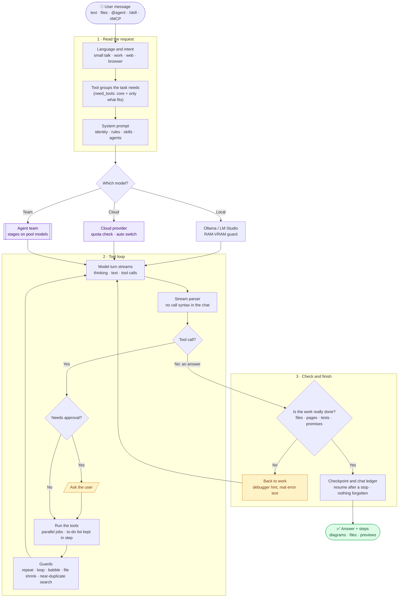
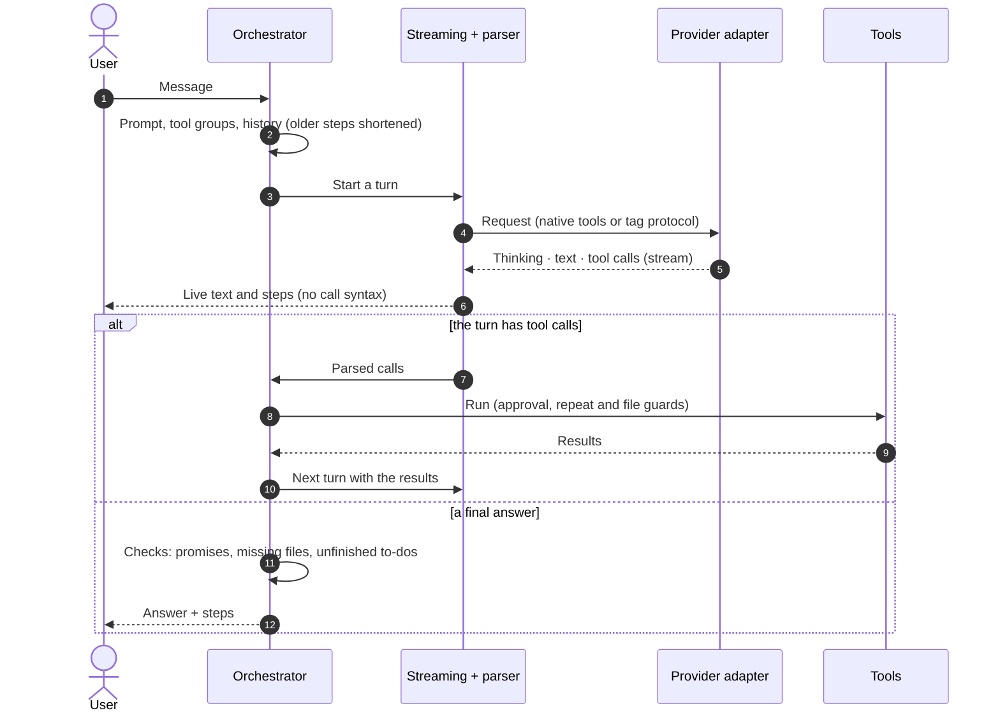
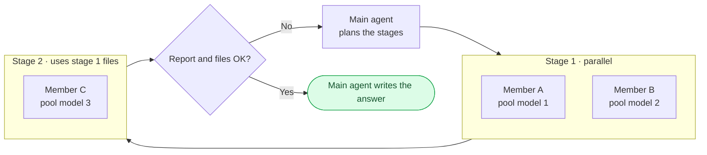
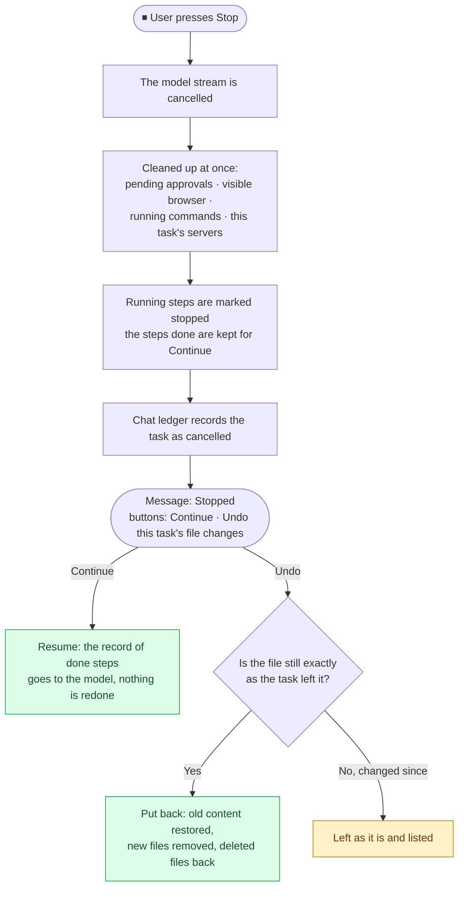
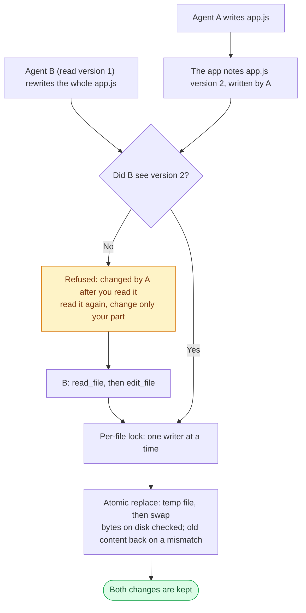
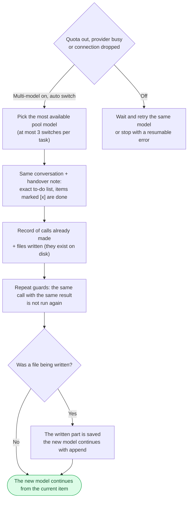
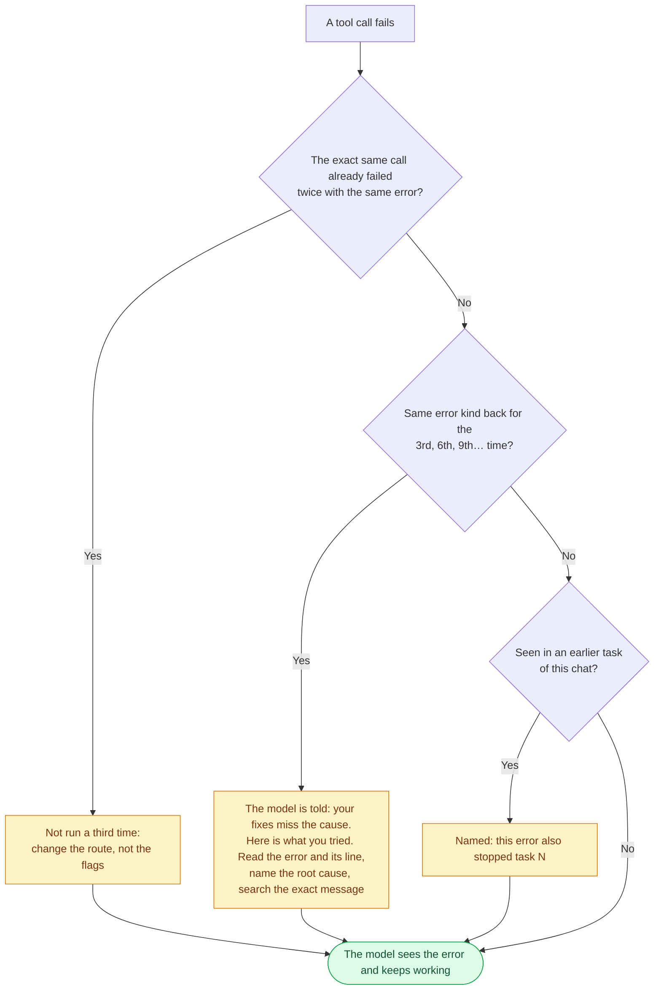

# How AI IQ 300 works

> [Türkçe](WORKFLOW.tr.md) · [README](README.md) · [Project state](PROJECT_STATE.md)

This page shows the path a message takes, from the message box to the finished answer. The diagrams are Mermaid
code, so GitHub draws them; the same code also draws in the app's chat.

## 1. Overview

- **Read the request.** The reply language and the intent come first. The prompt carries only the tool groups this
  conversation needs, so small and local models get a short prompt.
- **Pick the model.** A local model is loaded only when the machine has the memory for it. A cloud model is checked
  against its quota, and the task moves to another model when the quota runs out. A team splits the work into stages.
- **Tool loop.** The model streams its reasoning, text and tool calls. The parser hides every call format from the chat.
  Tools run (in parallel when they can), the to-do list follows the work, and guards stop repeats, loops, babble and
  file rewrites that would lose content.
- **Check and finish.** A reply that only promises work, or claims files and tests that do not exist, goes back to the
  loop with the real error. A finished task is saved as a checkpoint and shown with its steps. The app also writes the chat ledger (files,
  commands, environment, failures), so the next task starts knowing what was done.

## 2. One model turn

## 3. Agent team (cloud multi-model)

Each member runs its own tool loop on a model from the pool. Members of one stage work in parallel; a later stage
reads the files of the earlier ones. A model that hits its quota is swapped for another one in the pool.

## 4. Edge cases

What the app does when things do not go to plan. Each diagram follows the code as it is; the module names are in the
table below.

### 4.1 Stop in the middle of a task

- **Undone:** files changed by `write_file`, `edit_file` and `delete_file`. The state before the task's first change to
  each file is kept for the last 5 tasks of the chat.
- **Not undone:** changes made by shell commands (a build, `npm install`, a script). In a project, the git time machine
  under Files covers those.
- A file the user (or a later task) changed after the task is never overwritten by an undo.

### 4.2 Two agents change the same file

- `edit_file` and `write_file append` always apply to the file as it is under the lock, so they never lose another
  agent's change.
- A full rewrite is refused only when another agent **of the same task** changed the file after this agent last read
  it. A later task of the chat is not a parallel writer.
- The rewrite goes through on the third try, so a file too big to read whole is never a dead end. Its earlier version
  is in `.aiiq/backups`.

### 4.3 The model changes in the middle of a task

### 4.4 A fix that does not work

The user's rule: **no circuit breaker**. Errors are part of coding, so a count of failures never stops a task or
switches off the file and command tools. What the app prevents is the *same* thing happening again and again.

- **Every 4 failing turns in a row:** "you are stuck, take a different route".
- **The same call with the same result 3 times:** turned into a failure with an explanation.
- **Tools that are not needed for the work itself** (for example a search API that keeps refusing) are switched off for the task after 3 identical errors. File, command and read tools never are.
- **The step limit** (Settings > Agent, 60 by default, unlimited possible) ends the task; "Continue" resumes it with the record of what already ran.

## 5. Where it lives in the code

| Step | Module |
|---|---|
| Language, intent, tool groups, answer checks | `backend/app/agents/checks.py` |
| System prompt (identity, rules, capability map) | `agents/prompts.py`, `agents/prompting.py` |
| Run loop, final checks | `agents/orchestrator.py` |
| One streamed turn, stalls, loops | `agents/streaming.py`, `agents/stream_parser.py` |
| Running tools, to-do list, repeat guard | `agents/tooling.py` |
| Output guards (repeat, babble, word salad) | `agents/guards.py` |
| Checkpoints, resume, cut files | `agents/continuity.py` |
| Chat ledger (what earlier tasks did; `recall`) | `agents/ledger.py` |
| File locks, atomic writes, parallel-change check | `tools/safe_io.py` |
| Undo of a task's file changes | `tools/undo.py` |
| Recurring-error notes, repeat guards | `agents/tooling.py` |
| Handover after a model switch | `agents/continuity.py` (`_handover`), `agents/orchestrator.py` |
| Agent teams | `agents/team.py` |
| Providers, routing, quotas, model families | `llm/providers.py`, `llm/router.py`, `llm/usage.py`, `llm/families.py` |
| RAM / VRAM guard for local models | `llm/memguard.py` |
| Tools (files, shell, web, browser, docs, media, diagrams, system) | `backend/app/tools/` |
| Chat, diagrams, previews | `frontend/src/components/` |
