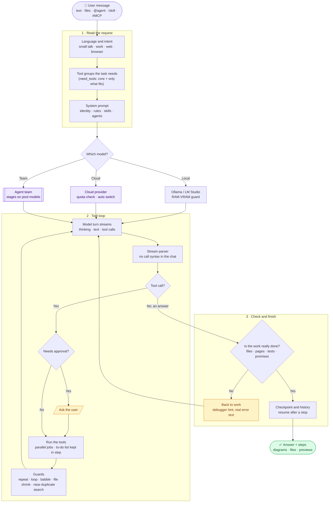
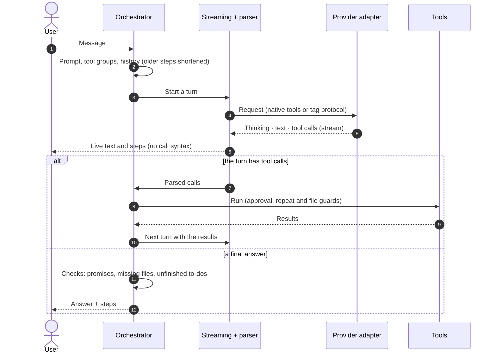

# How AI IQ 300 works

> [Türkçe](WORKFLOW.tr.md) · [README](README.md) · [Project state](PROJECT_STATE.md)

This page shows the path a message takes, from the message box to the finished answer. The diagrams are Mermaid
code, so GitHub draws them; the same code also draws in the app's chat.

## 1. Overview

- **Read the request.** The reply language and the intent come first. The prompt carries only the tool groups this
  conversation needs, so small and local models get a short prompt.
- **Pick the model.** A local model is loaded only when the machine has the memory for it. A cloud model is checked
  against its quota, and the task moves to another model when the quota runs out. A team splits the work into stages.
- **Tool loop.** The model streams its reasoning, text and tool calls. The parser hides every call format from the chat.
  Tools run (in parallel when they can), the to-do list follows the work, and guards stop repeats, loops, babble and
  file rewrites that would lose content.
- **Check and finish.** A reply that only promises work, or claims files and tests that do not exist, goes back to the
  loop with the real error. A finished task is saved as a checkpoint and shown with its steps.

## 2. One model turn

## 3. Agent team (cloud multi-model)

Each member runs its own tool loop on a model from the pool. Members of one stage work in parallel; a later stage
reads the files of the earlier ones. A model that hits its quota is swapped for another one in the pool.

## 4. Where it lives in the code

| Step | Module |
|---|---|
| Language, intent, tool groups, answer checks | `backend/app/agents/checks.py` |
| System prompt (identity, rules, capability map) | `agents/prompts.py`, `agents/prompting.py` |
| Run loop, final checks | `agents/orchestrator.py` |
| One streamed turn, stalls, loops | `agents/streaming.py`, `agents/stream_parser.py` |
| Running tools, to-do list, repeat guard | `agents/tooling.py` |
| Output guards (repeat, babble, word salad) | `agents/guards.py` |
| Checkpoints, resume, cut files | `agents/continuity.py` |
| Agent teams | `agents/team.py` |
| Providers, routing, quotas, model families | `llm/providers.py`, `llm/router.py`, `llm/usage.py`, `llm/families.py` |
| RAM / VRAM guard for local models | `llm/memguard.py` |
| Tools (files, shell, web, browser, docs, media, diagrams, system) | `backend/app/tools/` |
| Chat, diagrams, previews | `frontend/src/components/` |
