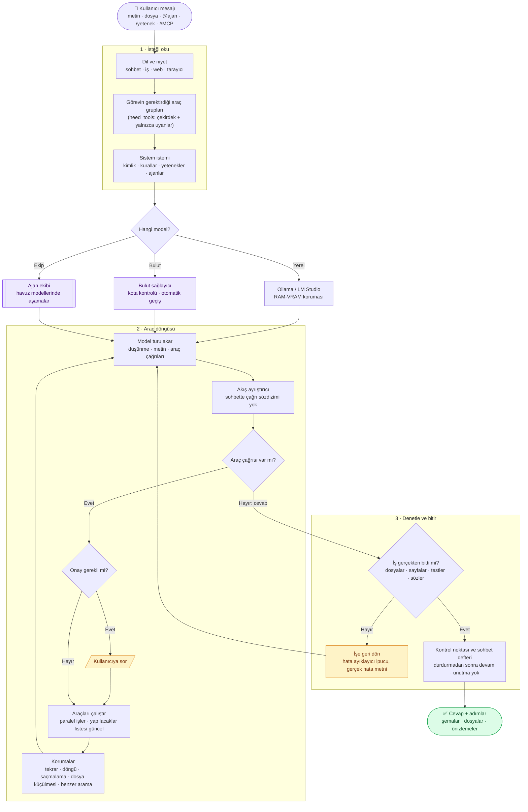
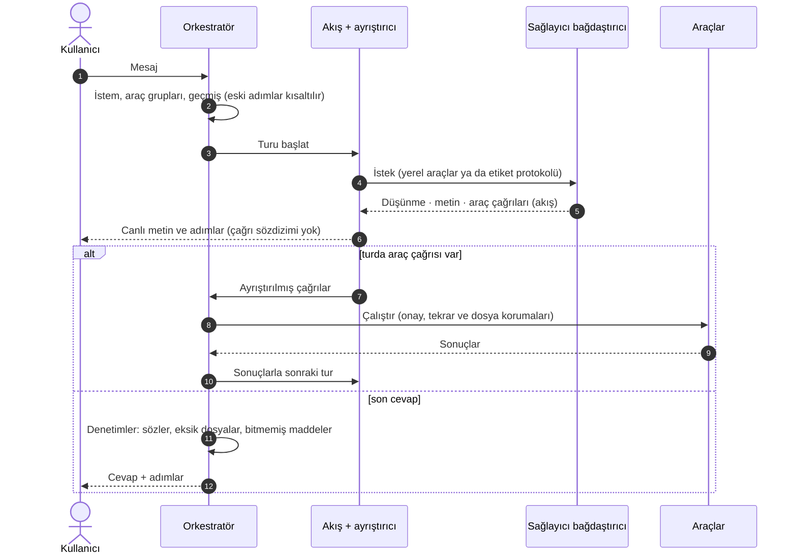
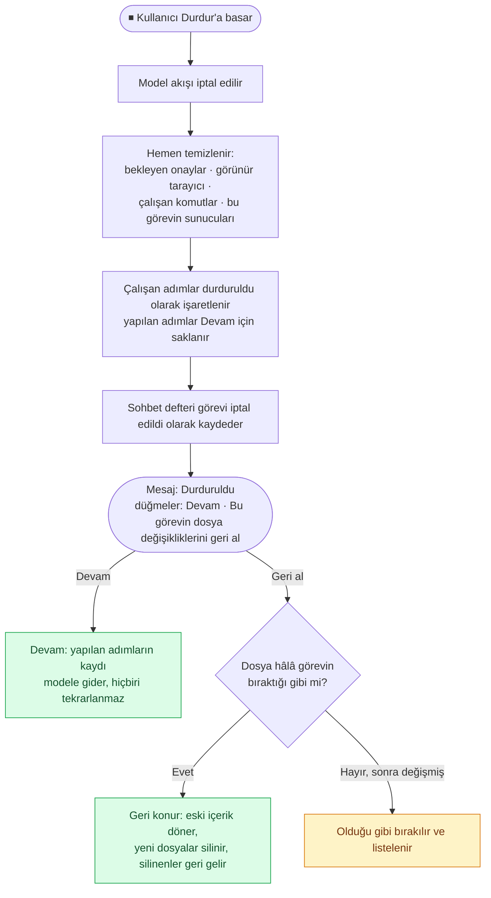
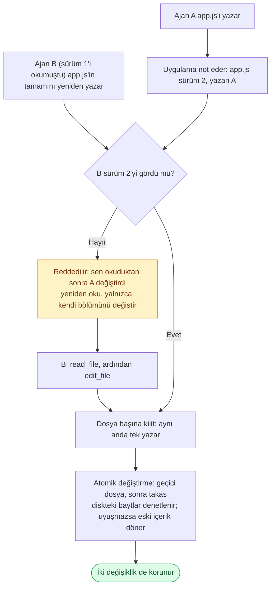
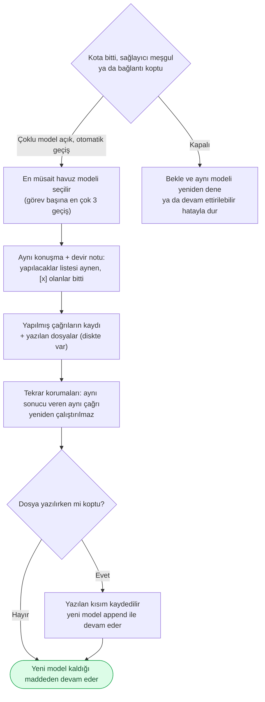
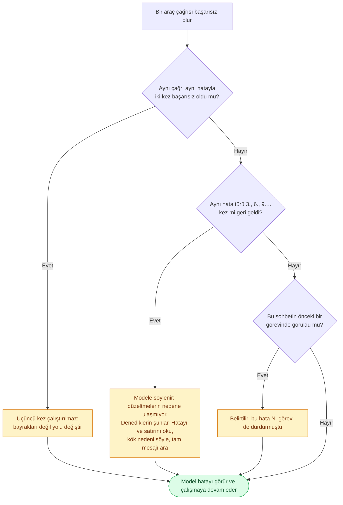

# AI IQ 300 nasıl çalışır

> [English](WORKFLOW.md) · [README](README.tr.md) · [Proje durumu](PROJECT_STATE.tr.md)

Bu sayfa bir mesajın mesaj kutusundan bitmiş cevaba kadar izlediği yolu gösterir. Şemalar Mermaid kodudur; GitHub
bunları çizer, aynı kod uygulamanın sohbetinde de çizilir.

## 1. Genel bakış

- **İsteği oku.** Önce cevap dili ve niyet belirlenir. İstem yalnızca bu sohbetin ihtiyaç duyduğu araç gruplarını
  taşır; küçük ve yerel modeller kısa bir istem alır.
- **Modeli seç.** Yerel model ancak bilgisayarda yeterli bellek varsa yüklenir. Bulut modelin kotası kontrol edilir,
  kota bitince görev başka bir modele geçer. Ekip, işi aşamalara böler.
- **Araç döngüsü.** Model düşüncesini, metnini ve araç çağrılarını akıtır. Ayrıştırıcı her çağrı biçimini sohbetten
  gizler. Araçlar (mümkünse paralel) çalışır, yapılacaklar listesi işi izler; korumalar tekrarları, döngüleri,
  saçmalamayı ve içerik kaybettirecek dosya yeniden yazımlarını durdurur.
- **Denetle ve bitir.** Yalnızca söz veren ya da olmayan dosya ve testleri iddia eden cevap, gerçek hata metniyle
  döngüye geri döner. Biten görev kontrol noktası olarak kaydedilir ve adımlarıyla gösterilir. Uygulama sohbet defterini de yazar
  (dosyalar, komutlar, ortam, hatalar); sonraki görev neyin yapıldığını bilerek başlar.

## 2. Bir model turu

## 3. Ajan ekibi (bulut çoklu model)

Her üye havuzdaki bir modelde kendi araç döngüsünü çalıştırır. Aynı aşamanın üyeleri paralel çalışır; sonraki aşama
öncekilerin dosyalarını okur. Kotası dolan model havuzdaki başka bir modelle değiştirilir.

## 4. Uç durumlar

İşler plana göre gitmediğinde uygulamanın ne yaptığı. Her şema kodun bugünkü davranışını izler; modül adları aşağıdaki
tablodadır.

### 4.1 Görev ortasında durdurma

- **Geri alınanlar:** `write_file`, `edit_file` ve `delete_file` ile değişen dosyalar. Her dosyanın görevin ilk
  değişikliğinden önceki hâli, sohbetin son 5 görevi için saklanır.
- **Geri alınmayanlar:** kabuk komutlarının yaptığı değişiklikler (derleme, `npm install`, bir betik). Projelerde
  bunları Dosyalar altındaki git zaman makinesi karşılar.
- Görevden sonra kullanıcının (ya da sonraki bir görevin) değiştirdiği dosyanın üzerine geri alma asla yazmaz.

### 4.2 İki ajan aynı dosyayı değiştirir

- `edit_file` ve `write_file append` her zaman dosyanın kilit altındaki o anki hâline uygulanır; başka ajanın
  değişikliğini kaybettirmez.
- Tam yeniden yazım yalnızca **aynı görevin** başka bir ajanı dosyayı, bu ajan son okuduktan sonra değiştirdiyse
  reddedilir. Sohbetin sonraki bir görevi paralel yazar sayılmaz.
- Yeniden yazım üçüncü denemede geçer; böylece tamamı okunamayacak kadar büyük bir dosya çıkmaza girmez. Eski sürümü
  `.aiiq/backups` klasöründe durur.

### 4.3 Görev ortasında model değişir

### 4.4 İşe yaramayan düzeltme

Kullanıcının kuralı: **devre kesici yok**. Hata kodlamanın parçasıdır; hata sayısı görevi asla durdurmaz, dosya ve
komut araçlarını kapatmaz. Uygulamanın engellediği şey *aynı* şeyin tekrar tekrar olmasıdır.

- **Art arda her 4 başarısız turda:** "takıldın, başka bir yol izle".
- **Aynı çağrı aynı sonucu 3 kez verirse:** açıklamalı bir hataya çevrilir.
- **İşin kendisi için gerekmeyen araçlar** (örneğin sürekli reddeden bir arama API'si) aynı hatayı 3 kez verince o görev için kapanır. Dosya, komut ve okuma araçları asla kapanmaz.
- **Adım sınırı** (Ayarlar > Ajan, varsayılan 60, sınırsız da olabilir) görevi bitirir; "Devam" yapılanların kaydıyla sürdürür.

## 5. Kodda nerede

| Adım | Modül |
|---|---|
| Dil, niyet, araç grupları, cevap denetimleri | `backend/app/agents/checks.py` |
| Sistem istemi (kimlik, kurallar, yetenek haritası) | `agents/prompts.py`, `agents/prompting.py` |
| Çalışma döngüsü, son denetimler | `agents/orchestrator.py` |
| Akan bir tur, takılmalar, döngüler | `agents/streaming.py`, `agents/stream_parser.py` |
| Araçları çalıştırma, yapılacaklar, tekrar koruması | `agents/tooling.py` |
| Çıktı korumaları (tekrar, saçmalama, kelime salatası) | `agents/guards.py` |
| Kontrol noktaları, devam, kesilen dosyalar | `agents/continuity.py` |
| Sohbet defteri (önceki görevler ne yaptı; `recall`) | `agents/ledger.py` |
| Dosya kilitleri, atomik yazım, paralel değişiklik denetimi | `tools/safe_io.py` |
| Bir görevin dosya değişikliklerini geri alma | `tools/undo.py` |
| Tekrarlayan hata notları, tekrar korumaları | `agents/tooling.py` |
| Model değişiminden sonra devir | `agents/continuity.py` (`_handover`), `agents/orchestrator.py` |
| Ajan ekipleri | `agents/team.py` |
| Sağlayıcılar, yönlendirme, kotalar, model aileleri | `llm/providers.py`, `llm/router.py`, `llm/usage.py`, `llm/families.py` |
| Yerel modeller için RAM / VRAM koruması | `llm/memguard.py` |
| Araçlar (dosya, kabuk, web, tarayıcı, belge, medya, şema, sistem) | `backend/app/tools/` |
| Sohbet, şemalar, önizlemeler | `frontend/src/components/` |
