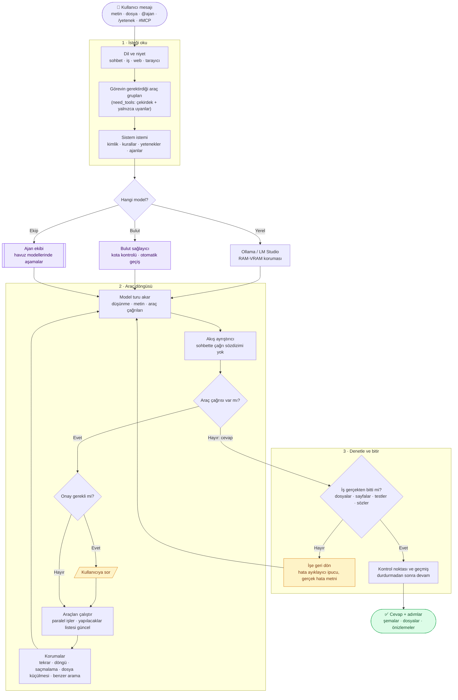
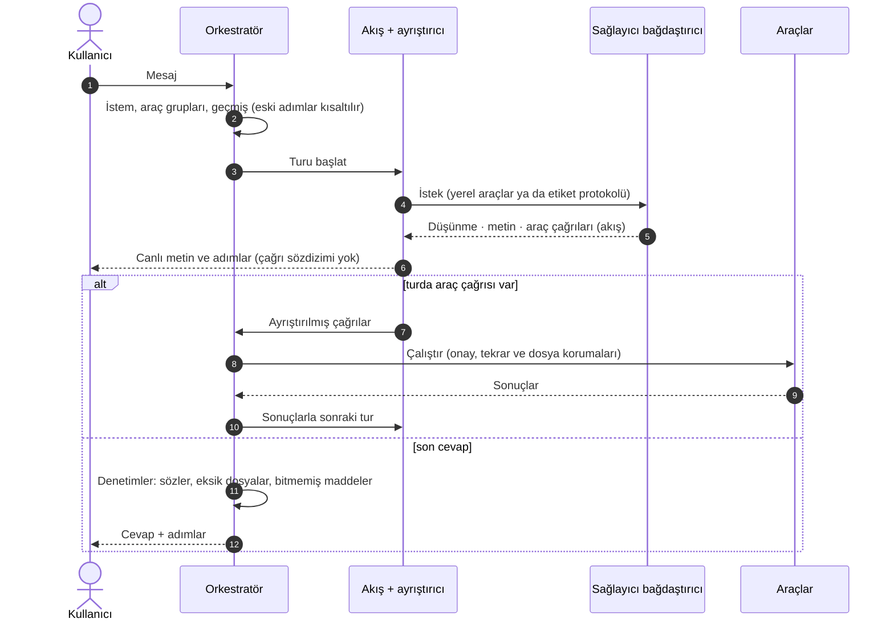
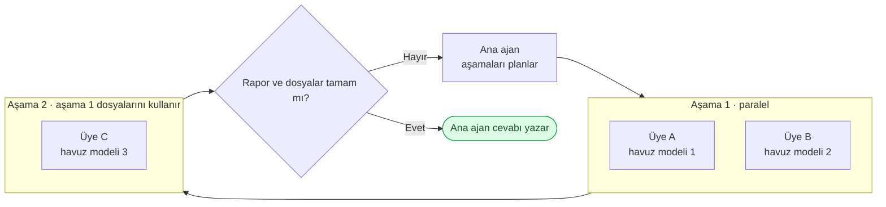

# AI IQ 300 nasıl çalışır

> [English](WORKFLOW.md) · [README](README.tr.md) · [Proje durumu](PROJECT_STATE.tr.md)

Bu sayfa bir mesajın mesaj kutusundan bitmiş cevaba kadar izlediği yolu gösterir. Şemalar Mermaid kodudur; GitHub
bunları çizer, aynı kod uygulamanın sohbetinde de çizilir.

## 1. Genel bakış

- **İsteği oku.** Önce cevap dili ve niyet belirlenir. İstem yalnızca bu sohbetin ihtiyaç duyduğu araç gruplarını
  taşır; küçük ve yerel modeller kısa bir istem alır.
- **Modeli seç.** Yerel model ancak bilgisayarda yeterli bellek varsa yüklenir. Bulut modelin kotası kontrol edilir,
  kota bitince görev başka bir modele geçer. Ekip, işi aşamalara böler.
- **Araç döngüsü.** Model düşüncesini, metnini ve araç çağrılarını akıtır. Ayrıştırıcı her çağrı biçimini sohbetten
  gizler. Araçlar (mümkünse paralel) çalışır, yapılacaklar listesi işi izler; korumalar tekrarları, döngüleri,
  saçmalamayı ve içerik kaybettirecek dosya yeniden yazımlarını durdurur.
- **Denetle ve bitir.** Yalnızca söz veren ya da olmayan dosya ve testleri iddia eden cevap, gerçek hata metniyle
  döngüye geri döner. Biten görev kontrol noktası olarak kaydedilir ve adımlarıyla gösterilir.

## 2. Bir model turu

## 3. Ajan ekibi (bulut çoklu model)

Her üye havuzdaki bir modelde kendi araç döngüsünü çalıştırır. Aynı aşamanın üyeleri paralel çalışır; sonraki aşama
öncekilerin dosyalarını okur. Kotası dolan model havuzdaki başka bir modelle değiştirilir.

## 4. Kodda nerede

| Adım | Modül |
|---|---|
| Dil, niyet, araç grupları, cevap denetimleri | `backend/app/agents/checks.py` |
| Sistem istemi (kimlik, kurallar, yetenek haritası) | `agents/prompts.py`, `agents/prompting.py` |
| Çalışma döngüsü, son denetimler | `agents/orchestrator.py` |
| Akan bir tur, takılmalar, döngüler | `agents/streaming.py`, `agents/stream_parser.py` |
| Araçları çalıştırma, yapılacaklar, tekrar koruması | `agents/tooling.py` |
| Çıktı korumaları (tekrar, saçmalama, kelime salatası) | `agents/guards.py` |
| Kontrol noktaları, devam, kesilen dosyalar | `agents/continuity.py` |
| Ajan ekipleri | `agents/team.py` |
| Sağlayıcılar, yönlendirme, kotalar, model aileleri | `llm/providers.py`, `llm/router.py`, `llm/usage.py`, `llm/families.py` |
| Yerel modeller için RAM / VRAM koruması | `llm/memguard.py` |
| Araçlar (dosya, kabuk, web, tarayıcı, belge, medya, şema, sistem) | `backend/app/tools/` |
| Sohbet, şemalar, önizlemeler | `frontend/src/components/` |
