# Benchmark

**English** · [Türkçe](BENCHMARK.tr.md)

Results of [the agent evaluation](README.md) on real models. Each row is one run of one task, scored from real output only. Newest first.

## 2026-11-23 · v0.20.1 · two NVIDIA models · nine tasks · Turkish prompts · one model at a time

| Model | Fully passed | Per check | Per task | Time | App errors |
|---|---|---|---|---|---|
| `nvidia/nemotron-3.5-super-vl-120b-a12b` | **9/9 (100%)** | 65/65 | 100% | 7.6 min | none |
| `nvidia/nemotron-3-ultra-550b-a55b` | **9/9 (100%)** | 65/65 | 100% | 32.8 min | none |




The interactive report is in [benchmark/report.en.html](benchmark/report.en.html); download it and open it in a browser. It has hover details, light and dark themes, and every check. The data is in [benchmark/results.json](benchmark/results.json).

**What counts is the success rate and no app errors.** The time mostly depends on the provider, not on the app:
- **550B:** 80% of its time was waiting for NVIDIA's free queue, about 26 s before each first token. The model wrote for 17% and the app took 0%.
- **3.5 Super:** 72% of its time was the model writing; the app took 1%.

| Task | 3.5 Super | Time (wait / generation) | 550B | Time (wait / generation) |
|---|---|---|---|---|
| Web app (browser test) | **8/8** | 80 s (17 / 49) | **8/8** | 331 s (253 / 38) |
| Fix broken Python | **3/3** | 37 s (4 / 31) | **3/3** | 200 s (163 / 33) |
| Five-file change | **4/4** | 36 s (9 / 26) | **4/4** | 273 s (246 / 25) |
| Word + PDF | **7/7** | 37 s (7 / 28) | **7/7** | 130 s (85 / 36) |
| Connection drop | **9/9** | 79 s (9 / 57) | **9/9** | 168 s (128 / 26) |
| Web research | **10/10** | 50 s (12 / 31) | **10/10** | 206 s (152 / 27) |
| Code review | **7/7** | 56 s (9 / 46) | **7/7** | 242 s (148 / 93) |
| Mermaid flowchart | **7/7** | 28 s (2 / 25) | **7/7** | 128 s (106 / 21) |
| Git branches | **10/10** | 52 s (14 / 34) | **10/10** | 294 s (249 / 43) |

Skill choice is a note, not a score. Neither model loaded a skill for the review, the flowchart or git, and both did the work right without one.

### Four rounds: what they found, and what was fixed

| Round | Found | Fix (v0.20.1) |
|---|---|---|
| 2 | 3.5 Super: five-file change took **1,040 s**. One turn wrote 131,072 tokens of blank output inside tool-call arguments (outside the blank-stream check), and the next request carried it all (141K-token prompt) | Blank check on tool-call deltas; repeat check on every big argument; stream cut 24K characters after the last complete call; blank runs not sent back → **36 s** |
| 2 | 3.5 Super guessed `models/product.py` for `shop/models.py` | A plain chat gets its file list in the prompt; "paths from the list or a tool result, then wait for results" |
| 2 | The break record said "do not read these files again"; models edited from memory | Read again when the content is no longer in the conversation; the ledger says it is a record, not the files |
| 2 | 3.5 Super, git: 0/2, nothing ran. It wrote `argument key="name" type="string"run…` with the brackets lost | Parser for that format; it counts as a leak (retry) when no call can be built |
| 2 | 3.5 Super cited `sqlite.org/license.html` (404) | – (the model's error; the checker opens every cited URL) → 10/10 in rounds 3 and 4 |
| 2 | A real network drop during the run ended tasks: the DNS branch gave up after two tries, and the simulated-network flag hid a real outage | DNS errors wait and retry until the network is back (no circuit breaker); the flag never masks a real outage |
| 3 | 550B, git: **1,602 s**, 1,171 s of it 429 backoff (two runs on one key), then 60 git branch/log calls in an unborn repository | Pacing lowers the rate for 10 min after a 429; the run result explains a repository with no commit yet → **294 s** |
| 3, 4 | The checkers: a finding written as a heading + body was "unrated"; an empty-state row made "Add" look broken; parallel tool time was summed | Checkers fixed, runs re-scored on their own files with `--rescore`; tool time is wall time |
| – | Users saw no "read" on search cards: models used `web_search` and answered from snippets | `web_search` reads the top two sources |

Round 4 is the result above. Round 3 already gave 3.5 Super 9/9 (after the checker fix) and 550B 8/9 (git).

## 2026-11-23 · v0.20.0 · `evren:auto` · Turkish prompts · CPU-only PC (the model runs in the cloud)

| Task | Checks | Status | Time | Turns | Output tokens | Tool calls (errors) | Retries | Model switches |
|---|---|---|---|---|---|---|---|---|
| Web app (3rd run, after the folder fix) | **8/8** | ok | 1022 s | 22 | 4,696 | 16 (0) | 1 | 0 |
| Fix broken Python | **3/3** | ok | 262 s | 8 | 2,064 | 8 (0) | 0 | 0 |
| Five-file change | **4/4** ¹ | ok | 1008 s | 21 | 4,585 | 18 (1) | 0 | 0 |
| Word + PDF | **7/7** | ok | 537 s | 12 | 2,552 | 8 (2) | 0 | 0 |
| Connection drop | **9/9** | ok | 268 s | 7 | 2,161 | 5 (0) | 1 | 0 |

**All five tasks pass: 31/31 checks.**

### What the runs found, and what was fixed

| Run | Result | Cause | Fix in v0.20.0 |
|---|---|---|---|
| Web app, 1st | 0/4, stopped at 1200 s | The files were written to the chat's root, not `todo/`; `browser_key {"key": "F5", "keys": ""}` was refused 3 times | `browser_key` takes the key from `key` / `ref` |
| Web app, 2nd | 5/8 | The app works (Add, reload, no console errors), but the files were in the root again | The app checks that files listed for a named folder are in it; at the end of the task the model is told and moves them |
| Web app, 3rd | 8/8 | The model wrote to the root, was told, moved the files into `todo/` with one command, and tested `todo/index.html` again | – |
| Five-file change | 3/4 → 4/4 | The checker counted the English word "price" in a docstring as a leftover | Checker fixed (Python names only); the model's change was right |

¹ Scored with the fixed checker on the same files.

**Connection drop:** the runner cut the model's stream 97 s into the task, 71 KB into a reply, for 8 s. The app noticed, waited, and continued with the same model. All four files were complete and none was written twice.

**Tool errors that the model recovered from by itself:** two `edit_file` calls in a form the app did not recognise (the next call worked), and one Python script of the model's that exited with an error.

## Run it yourself

```powershell
.venv\Scripts\python.exe eval\run_eval.py --models "nvidia:nvidia/nemotron-3.5-super-vl-120b-a12b"
```

Run models that share one API key one after another, not in parallel: they share its rate limit, and the waits spoil
the times. The report is written to `eval/reports/<date-time>/` (`report.html`, `report.md`, `report.json`, charts,
traces). Add your results here with the date, version, model and language.
