# Benchmark

[English](BENCHMARK.md) · **Türkçe**

[Ajan değerlendirmesinin](README.tr.md) gerçek modellerdeki sonuçları. Her satır bir görevin bir çalıştırmasıdır ve yalnızca gerçek çıktıya göre puanlanır. En yenisi üstte.

## 2026-11-23 · v0.20.1 · iki NVIDIA modeli · dokuz görev · Türkçe görev metinleri · modeller tek tek

| Model | Tam geçen | Kontrol bazında | Görev bazında | Süre | Uygulama hatası |
|---|---|---|---|---|---|
| `nvidia/nemotron-3.5-super-vl-120b-a12b` | **9/9 (%100)** | 65/65 | %100 | 7,6 dk | yok |
| `nvidia/nemotron-3-ultra-550b-a55b` | **9/9 (%100)** | 65/65 | %100 | 32,8 dk | yok |




Etkileşimli rapor [benchmark/report.tr.html](benchmark/report.tr.html) dosyasında; indirip tarayıcıda aç. Üzerine gelince ayrıntılar, açık ve koyu tema ve tüm kontroller orada. Veriler [benchmark/results.json](benchmark/results.json) dosyasında.

**Önemli olan başarı oranı ve uygulama hatası olmaması.** Süre çoğunlukla uygulamaya değil sağlayıcıya bağlı:
- **550B:** sürenin %80'i NVIDIA'nın ücretsiz kuyruğunda bekleyerek geçti; her ilk token'dan önce yaklaşık 26 sn. Model %17 yazdı, uygulama %0.
- **3.5 Super:** sürenin %72'si modelin yazmasıydı; uygulama %1.

| Görev | 3.5 Super | Süre (bekleme / üretim) | 550B | Süre (bekleme / üretim) |
|---|---|---|---|---|
| Web uygulaması (tarayıcı testi) | **8/8** | 80 sn (17 / 49) | **8/8** | 331 sn (253 / 38) |
| Bozuk Python düzeltme | **3/3** | 37 sn (4 / 31) | **3/3** | 200 sn (163 / 33) |
| 5 dosyalı değişiklik | **4/4** | 36 sn (9 / 26) | **4/4** | 273 sn (246 / 25) |
| Word + PDF | **7/7** | 37 sn (7 / 28) | **7/7** | 130 sn (85 / 36) |
| Bağlantı kopması | **9/9** | 79 sn (9 / 57) | **9/9** | 168 sn (128 / 26) |
| Web araştırması | **10/10** | 50 sn (12 / 31) | **10/10** | 206 sn (152 / 27) |
| Kod incelemesi | **7/7** | 56 sn (9 / 46) | **7/7** | 242 sn (148 / 93) |
| Mermaid akış şeması | **7/7** | 28 sn (2 / 25) | **7/7** | 128 sn (106 / 21) |
| Git dalları | **10/10** | 52 sn (14 / 34) | **10/10** | 294 sn (249 / 43) |

Beceri seçimi puan değil, nottur. İki model de inceleme, akış şeması ve git için beceri yüklemedi, işi becerisiz doğru yaptı.

### Dört tur: ne bulundu, ne düzeltildi

| Tur | Bulunan | Düzeltme (v0.20.1) |
|---|---|---|
| 2 | 3.5 Super: 5 dosyalı değişiklik **1.040 sn** sürdü. Bir tur, araç çağrısı argümanlarının içinde 131.072 token boşluk yazdı (boş akış denetiminin dışında); sonraki istek hepsini taşıdı (141K token'lık istem) | Araç çağrısı parçalarında boşluk denetimi; her büyük argümanda tekrar denetimi; son tam çağrıdan 24K karakter sonra akış kesilir; boşluk dizileri geri gönderilmez → **36 sn** |
| 2 | 3.5 Super, `shop/models.py` yerine `models/product.py` tahmin etti | Düz sohbet istemde dosya listesini alır; "yollar listeden ya da araç sonucundan gelir, sonra sonuçları bekle" |
| 2 | Kopma kaydı "bu dosyaları yeniden okuma" diyordu; modeller ezberden düzenledi | İçerik sohbette yoksa yeniden okunur; kayıt defteri dosyaların kendisi değil, bir kayıt olduğunu söyler |
| 2 | 3.5 Super, git: 0/2, hiçbir şey çalışmadı. Parantezleri kaybolmuş `argument key="name" type="string"run…` yazdı | Bu biçim için ayrıştırıcı; çağrı kurulamazsa sızıntı sayılır (yeniden dener) |
| 2 | 3.5 Super `sqlite.org/license.html` (404) kaynak gösterdi | – (modelin hatası; denetleyici her kaynağı açar) → 3. ve 4. turda 10/10 |
| 2 | Çalışma sırasında gerçek bir ağ kopması görevleri bitirdi: DNS dalı iki denemede vazgeçiyordu, benzetilmiş ağ bayrağı gerçek kesintiyi gizliyordu | DNS hataları ağ dönene kadar bekleyip yeniden dener (devre kesici yok); bayrak gerçek kesintiyi asla gizlemez |
| 3 | 550B, git: **1.602 sn**, 1.171 sn'si 429 geri çekilmesi (tek anahtarda iki çalışma), ardından henüz commit'i olmayan bir depoda 60 git branch/log çağrısı | 429'dan sonra hız 10 dk düşürülür; çalıştırma sonucu commit'siz depoyu açıklar → **294 sn** |
| 3, 4 | Denetleyiciler: başlık + gövde olarak yazılan bulgu "derecesiz" sayıldı; boş liste satırı "Ekle"yi bozuk gösterdi; paralel araç süresi toplandı | Denetleyiciler düzeltildi, çalıştırmalar kendi dosyalarıyla `--rescore` ile yeniden puanlandı; araç süresi duvar saati |
| – | Kullanıcılar arama kartlarında "okundu" görmedi: modeller `web_search` kullanıp özetlerden cevap verdi | `web_search` ilk iki kaynağı okur |

Yukarıdaki sonuç 4. turdur. 3. turda 3.5 Super zaten 9/9 (denetleyici düzeltmesinden sonra), 550B 8/9 (git) almıştı.

## 2026-11-23 · v0.20.0 · `evren:auto` · Türkçe görev metinleri · yalnızca CPU'lu PC (model bulutta çalışır)

| Görev | Kontrol | Durum | Süre | Tur | Çıktı token | Araç çağrısı (hata) | Yeniden deneme | Model değişimi |
|---|---|---|---|---|---|---|---|---|
| Web uygulaması (klasör düzeltmesinden sonra 3. çalıştırma) | **8/8** | ok | 1022 sn | 22 | 4.696 | 16 (0) | 1 | 0 |
| Bozuk Python düzeltme | **3/3** | ok | 262 sn | 8 | 2.064 | 8 (0) | 0 | 0 |
| 5 dosyalı değişiklik | **4/4** ¹ | ok | 1008 sn | 21 | 4.585 | 18 (1) | 0 | 0 |
| Word + PDF | **7/7** | ok | 537 sn | 12 | 2.552 | 8 (2) | 0 | 0 |
| Bağlantı kopması | **9/9** | ok | 268 sn | 7 | 2.161 | 5 (0) | 1 | 0 |

**Beş görevin hepsi geçti: 31/31 kontrol.**

### Çalıştırmaların bulduğu ve düzeltilenler

| Çalıştırma | Sonuç | Neden | v0.20.0'daki düzeltme |
|---|---|---|---|
| Web uygulaması, 1. | 0/4, 1200 sn'de durduruldu | Dosyalar `todo/` yerine sohbetin köküne yazıldı; `browser_key {"key": "F5", "keys": ""}` 3 kez reddedildi | `browser_key` tuşu `key` / `ref` alanından da alır |
| Web uygulaması, 2. | 5/8 | Uygulama çalışıyor (Ekle, yenileme, konsol hatası yok), ama dosyalar yine kökte | Uygulama, adı verilen bir klasör için sayılan dosyaların o klasörde olduğunu denetler; görevin sonunda modele söylenir ve model dosyaları taşır |
| Web uygulaması, 3. | 8/8 | Model köke yazdı, uyarıyı aldı, dosyaları tek komutla `todo/` içine taşıdı ve `todo/index.html`'i yeniden test etti | – |
| 5 dosyalı değişiklik | 3/4 → 4/4 | Denetleyici, bir docstring'deki İngilizce "price" sözcüğünü kalıntı saydı | Denetleyici düzeltildi (yalnızca Python adları); modelin değişikliği doğruydu |

¹ Aynı dosyalar üzerinde düzeltilmiş denetleyiciyle puanlandı.

**Bağlantı kopması:** runner, görevin 97. saniyesinde, bir cevabın 71 KB'ında modelin akışını 8 sn kesti. Uygulama bunu fark etti, bekledi ve aynı modelle devam etti. Dört dosya da tamdı, hiçbiri iki kez yazılmadı.

**Modelin kendi kendine toparladığı araç hataları:** uygulamanın tanımadığı biçimde iki `edit_file` çağrısı (bir sonraki çağrı çalıştı) ve modelin kendi yazdığı, hatayla çıkan bir Python betiği.

## Kendin çalıştır

```powershell
.venv\Scripts\python.exe eval\run_eval.py --models "nvidia:nvidia/nemotron-3.5-super-vl-120b-a12b"
```

Aynı API anahtarını paylaşan modelleri paralel değil, tek tek çalıştır: anahtarın hız sınırını paylaşırlar ve
beklemeler süreleri bozar. Rapor `eval/reports/<tarih-saat>/` klasörüne yazılır (`report.html`, `report.md`,
`report.json`, grafikler, iz kayıtları). Sonuçlarını tarih, sürüm, model ve dil ile buraya ekle.
